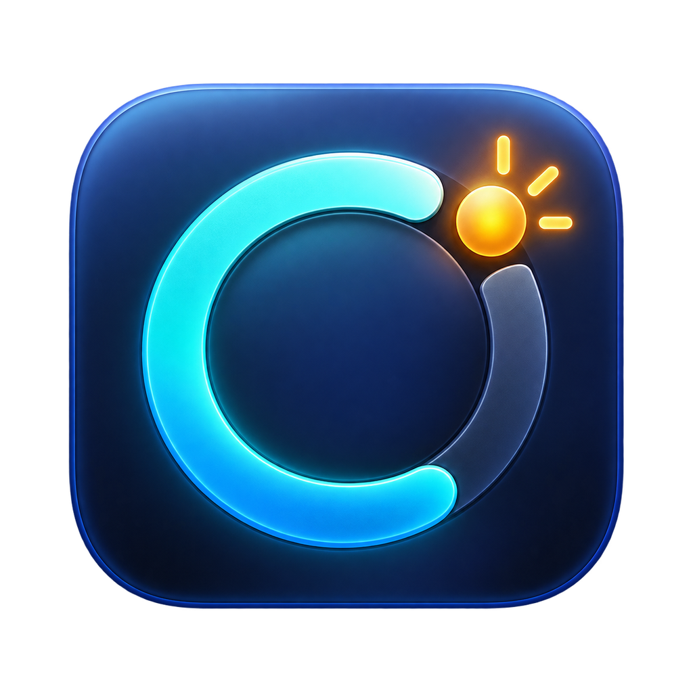

# Codex Usage Alert / 用量预警

<p align="center">
  
</p>

一个原生 macOS 菜单栏用量监控器，同时监控 Codex 和 Grok Bot。Codex 通过本机 `codex app-server` 读取额度与 Token 活动；Grok Bot 读取本地 JSON 文件，也可在设置中手动填写。两项服务分别记录当日增量，并发送分级系统通知。

> 本项目是独立的开源工具，不是 OpenAI 官方产品。应用不会要求或保存你的账号密码、Cookie 或 API Key。

## 功能

- 双环形卡片显示 Codex 与 Grok Bot 的周期用量和重置时间，可切换详情
- 菜单栏默认以 C / G 两条小进度条同时显示 Codex 和 Grok Bot；填充表示已用，空白表示剩余，悬停查看精确比例
- 设置可切换双进度条、双服务数字或最高值；关闭、过期或无效的服务置灰，不显示旧比例
- 设置可分别开关两项服务；Grok Bot 支持手动填写百分比与重置时间
- Grok Bot 文件缺失、无效或超过 24 小时未更新时显示状态，不参与通知或最高值计算
- 菜单栏使用随系统深浅背景适配的模板矢量图形，支持高分屏
- 点击应用图标打开完整仪表盘，同时保留菜单栏入口
- 自动刷新频率可设置，默认 15 分钟；也可选择固定时间刷新
- 显示已用额度、剩余额度、额度周期和重置时间
- 按本地自然日记录基线，估算当天增加的额度百分点
- 当日增量达到 5、10、15、20 个百分点时发送分级通知
- 同一阈值当天只通知一次，避免重复打扰
- 显示本月截至今日 Token、本月单日峰值、历史累计、连续使用天数和最近 7 个活跃日趋势
- Token 数量单位可切换中文（万、亿）或英文（K、M、B）
- 内置通知测试、通知设置入口和登录时自动启动
- 附带 `codex-usage` JSON 命令行读取器

## 系统要求

- macOS 13 或更高版本
- Swift 6 工具链
- 监控 Codex 时：本机已安装 Codex CLI 或 ChatGPT/Codex macOS 应用
- 监控 Codex 时：已使用支持 Codex 服务的 ChatGPT 身份登录
- 仅监控 Grok Bot 时无需安装或登录 Codex

## Grok Bot 接入

Grok Bot 没有公开用量 API。本应用不会自动获取 Grok 账号用量，而是每分钟读取 `~/Library/Application Support/CodexUsageAlert/grok-usage.json`。设置中的手动填写也写入此文件；计数由文件提供，首次手动创建为 0。文件需由你或外部工具持续更新。格式、原子写入约定及过期规则见 [Grok Bot 用量文件说明](docs/grok-usage-format.md)。

每项服务当天的第一笔有效读数作为基线，关闭期间的用量无法完整还原；阈值按本地自然日去重。20 个百分点是个人提醒预算，并非服务官方限制。

## 数据来源

应用启动本机 `codex app-server`，使用官方 JSON-RPC 方法：

- `account/rateLimits/read`：额度窗口、已用百分比和重置时间
- `account/usage/read`：Token 活动摘要和每日数据

Token 活动接口不可用时，额度监控仍会继续工作。`20%` 是应用默认的个人每日预算，不是 OpenAI 官方硬限制。

参考：[Codex App Server 文档](https://learn.chatgpt.com/docs/app-server)

## 构建与运行

```bash
swift build && swift test
./scripts/sync_version.sh
./scripts/build_app.sh
open "dist/Codex Usage Alert.app"
```

构建结果位于 `dist/Codex Usage Alert.app`。首次启动时，请在 macOS 权限提示中允许系统通知。

命令行读取器：

```bash
swift run codex-usage --pretty
```

## 项目结构

```text
Sources/UsageCore/          数据模型、规则与 App Server 客户端
Sources/CodexUsageAlert/    SwiftUI 应用、监控和系统通知
Sources/CodexUsageCLI/      JSON 命令行读取器
Tests/UsageCoreTests/       核心逻辑测试
Resources/                  Info.plist 与应用图标
scripts/build_app.sh        .app 构建和临时签名脚本
docs/                       开发计划、提示词和项目文档
```

## 项目文档

项目文档统一保存在 [`docs`](docs/README.md) 目录，包括：

- [Mac App Store 开发计划](docs/app-store-development-plan.md)
- [Mac App Store 上架资料](docs/app-store-metadata.md)
- [从零生成 Codex 用量预警的完整开发提示词](docs/development-prompt.md)

## 分发说明

构建脚本使用临时签名，适合本机运行和开发测试。正式对外分发需要 Apple Developer ID 签名与公证；Mac App Store 版本还需要完成 App Sandbox 和正式 Xcode 分发工程改造，详见[开发计划](docs/app-store-development-plan.md)。

## 隐私

- 用量数据仅在本机展示和保存必要的每日基线。
- 不收集账号邮箱、凭据或完整 App Server 日志。
- 不包含遥测或第三方分析 SDK。

## License

[MIT](LICENSE)
